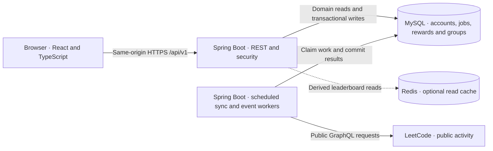
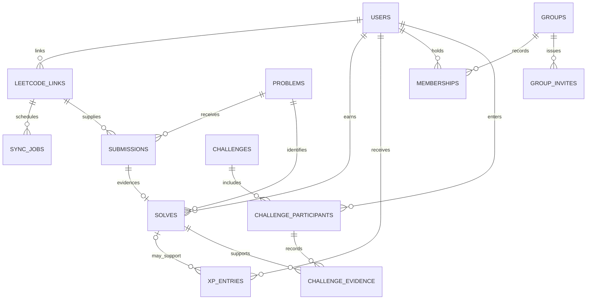
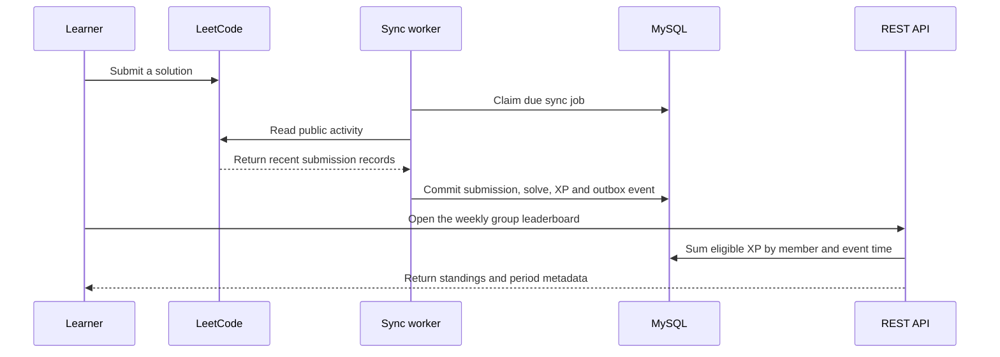

# LeetGrind system architecture

**Status** Proposed design. The [implementation plan](implementation-plan.md) defines the product requirements and technology stack. The decisions marked as proposals below are defaults for the first release.

## 1. Product and system boundaries

LeetGrind helps students and early-career developers sustain data structures and algorithms (DSA) practice with their peers. A study group can see progress and compete using eligible LeetCode activity that LeetGrind imports automatically. A learner solves and submits code on LeetCode, links their public profile in LeetGrind, and sees the resulting XP, streaks, and group standings after a sync.

The first release proves one complete path: **create an account → link a LeetCode profile → join a private group → solve on LeetCode → receive XP and a weekly ranking**. Public groups, additional ranking periods, daily problems, quests, duels, achievements, feeds, and recommendations extend this path. LeetCode owns problem solving and submission evaluation. LeetGrind stores the public activity metadata needed to calculate progress and rankings.

## 2. System topology

Use a modular monolith. React and TypeScript implement the browser UI. A Java and Spring Boot application serves versioned REST endpoints and runs scheduled synchronization. MySQL owns durable state through Spring Data JPA and Hibernate, with explicit SQL for queries that benefit from aggregation or row locking. Redis can cache derived reads when measured traffic warrants it. Document the REST API with OpenAPI and package the application in Docker.

The API and workers initially run in the same Spring Boot deployment, with separate executors and bounded concurrency for background work. The deployment can later run API and worker replicas from the same image. Job leases in MySQL coordinate workers across replicas. The browser uses LeetGrind endpoints for product data and follows external links when the user chooses to solve a problem.

### Module boundaries

Use top-level Java packages by domain. Give each module ownership of its writes and keep its persistence classes private. Cross-module write operations go through application services. Explicit read queries can join across domains for projections such as leaderboards.

- **Identity** owns LeetGrind accounts, credentials, sessions, display names, and privacy settings.
- **Integration** owns LeetCode links, ownership status, the public GraphQL adapter, sync jobs, and normalized submission metadata. It emits accepted activity for downstream use.
- **Problem catalog** owns problem identifiers, titles, difficulty, and topic mappings. The integration refreshes catalog data through its service.
- **Progress and rewards** owns recorded solves, the append-only XP ledger, level thresholds, and coding-day summaries. It credits base XP synchronously with accepted activity ingestion.
- **Groups and standings** owns group settings, roles, invitation redemption, and membership intervals. Standings query the XP ledger against those intervals and the requested period.
- **Challenges and achievements** owns featured problems, quest definitions, enrollments, duels, achievements, completion evidence, and reward requests. It consumes recorded solve events.
- **Activity and insights** builds feeds, notifications, personal analytics, and rule-based recommendations from committed activity. Visibility is checked at read time against current access.

The integration adapter maps upstream responses into internal records. Reward and group code use internal identifiers and timestamps. Keep database transaction boundaries in application services so the sync workflow can call integration, catalog, and rewards services in one transaction.

## 3. Data model

Use foreign keys for durable relationships, UTC timestamps at subsecond precision, and integer XP values. Preserve both when the activity occurred (`occurred_at`) and when LeetGrind recorded it (`recorded_at`). The event time determines eligibility and period attribution. The recorded time supports monitoring and reconciliation. The names below are logical schema names.

### Accounts, competition, and provenance

- **`users`** — ID, normalized email (unique), password hash, unique public handle, display name, and account status. **`refresh_sessions`** — user, token digest, expiry, rotation family, and revocation timestamps.
- **`leetcode_links`** — user, provider account identity when available, normalized handle, verification status, verified time, activation time, deactivation time, and version. Reserve verified provider identities uniquely and enforce one active verified link per user with a database constraint or an active-link table. Keep a link record as provenance after disconnection.
- **`sync_jobs`** — link and version, status, next run time, lease token and expiry, attempt count, last error category, and bounded retry state. Enforce one schedulable job per link version. Index due jobs by state and run time. Store owner-visible sync watermarks and last successful sync on the link.
- **`problems`**, **`topics`**, **`problem_topics`** — stable provider problem identifier where available, slug, display metadata, difficulty, and many-to-many topics. Use a stable problem identity for deduplication across metadata updates.
- **`practice_catalog`** and **`practice_catalog_topics`** store curated recommendation problems and topic mappings. Once a provider problem maps to an entry, later slug or title updates preserve the association. V7 backfills by provider and slug, using earlier committed solve-event slugs for unambiguous renamed problems.
- **`submissions`** — actor, provider submission identity, problem, source link, acceptance time, first recorded time, validation status, and metadata needed for attribution. Uniqueness is provider plus submission identity, scoped to the provider account if necessary. Delay scoring anything that cannot be uniquely attributed or whose difficulty is unresolved.
- **`solves`** — one qualifying solve per LeetGrind user and canonical problem, enforced by a unique key. Store the evidence submission, effective solve time, and difficulty at credit time. This is the record used for distinct solved counts and baseline competition credit.
- **`xp_entries`** — user, signed amount, reason, deterministic reward key, source reference, effective time, recorded time, and rule version. Enforce uniqueness on `(user_id, reward_key)`. A correction is a compensating entry referencing the original entry and using that entry's effective time for period calculations. Ensure a correction can be applied only once per correction key.
- **`groups`**, **`memberships`**, **`group_invites`** — group visibility and status, membership role and active interval, and invitation digest, expiry, revocation and redemption limits. Preserve membership intervals on leave and rejoin. Use a unique active-membership record or equivalent database constraint and close or open intervals within the same transaction. The active owner must transfer ownership or close the group before leaving.
- **`outbox_events`** — event ID, type, version, aggregate ID, payload, recorded time, and dispatch state. The practice rewards consumer commits the dispatch marker with its derived writes. Independent future consumers can use **`processed_events`** with a unique `(consumer, event_id)` key. Keep payloads limited to references and fields consumers need.

### Engagement and read models

- **`reward_windows`** stores featured and quest instances by provider, type, and UTC start, with their deadlines, rule versions, targets, XP, and catalog snapshots. **`reward_evidence`** stores each qualifying solve once per instance and account. **`user_achievements`** stores a versioned unlock once per account, provider, and code. **`level_thresholds`** stores threshold sets by rule version. **`coding_days`** derives one row per account, provider, and UTC date from credited solves.
- **`challenges`**, **`challenge_participants`**, and **`challenge_evidence`** store group challenges and duels, versioned scoring rules and UTC windows, invitations and enrollment, finalized scores and outcomes, and the solves used for each result. Evidence is unique by `(challenge_id, account_id, solve_id)`.
- **`notifications`** stores the recipient, source key, notification type, created and read timestamps, and group or competition references. Each `(recipient, type, source key)` is unique. Inbox reads and referenced endpoints check current access.
- Begin with query-time standings and personal summaries. Index XP by actor and effective time, memberships by group, actor and time range, and solves by user and effective time. Add materialized per-period scores when query latency or database load justifies them. MySQL remains the source of truth.

## 4. Profile linking and synchronization

### Linking and integration gate

The first engineering milestone validates the public LeetCode integration with approved test profiles. Establish what identity, submission ID, acceptance status, problem ID, timestamp, difficulty, and history coverage can be reliably obtained. Record observed throttling and response changes in adapter fixtures. Confirm a supported way to prove ownership before enabling group rewards for a link.

A LeetGrind user can enter a public handle to start linking. The backend normalizes the handle and resolves the provider identity. A resolvable public handle alone provides no ownership proof. The proposed release rule allows a pending or unverified handle to preview public data privately and requires verified ownership before granting any competitive credit. The exact verification mechanism is an implementation gate. No LeetCode password or session cookie is needed.

On disconnect, deactivate the link and increment its version so work claimed earlier cannot credit a disconnected or replaced link. Preserve previously earned XP and the activity that supports it, subject to the account deletion policy. Require verification again before reactivation. Keep provider identity binding and provenance across disconnects to prevent XP from being reissued to another account by relinking the same identity. A contested ownership transfer needs an explicit support procedure.

### Fetch, validate, and commit

1. The scheduler selects due jobs in a short transaction, assigning a lease token and expiry with row locking. A manual sync request schedules the same job and returns its current state. Limit per-account triggers and total provider request concurrency.
2. The worker fetches public activity outside the database transaction, with bounded request time and page count. Fetch overlapping windows where the upstream data supports them. Treat partial responses, rate limits, and schema errors as distinct outcomes.
3. Validate records and resolve catalog metadata. In a short transaction, lock the relevant link and job, check the lease and link version, and insert submissions using the upstream identity constraint. For each newly eligible problem, insert the solve, base XP, and a `SolveCredited` outbox event in the same transaction. Handle unique-key conflicts as idempotent replays.
4. Advance the sync checkpoint and set `lastSuccessfulSyncAt` only when the intended fetch and processing range completes. Valid items from a partial response may already be committed. Subsequent attempts repeat the overlap safely. Keep any unresolved items in a bounded retry state with a visible coverage or validation status.
5. Process outbox work after commit. Within each consumer's transaction, persist both the effect and its deduplication record. A worker crash after commit is safe to replay. Quests, notifications, and rebuildable projections may lag the base XP write.

If the provider exposes a bounded recent feed, a successful poll confirms receipt of that feed. It cannot establish complete historical coverage. Track gaps when the source provides enough evidence to detect one and surface coverage uncertainty on the profile. Avoid permanently skipping ties at a cursor boundary by using a provider cursor or overlapping timestamps and deduplicating by ID.

## 5. Rules for XP, time, and visibility

The amounts come from the implementation plan. The scoring scope, time rules, and tie behavior below are proposed defaults.

- **Base XP.** Easy earns 10 XP, Medium 25 XP, and Hard 50 XP. Credit the first verifiable eligible solve observed for a distinct problem per user. A resubmission of that problem adds no base XP. Within one fetched batch, process oldest activity first with a stable ID tie-break. Later discovery of an older submission does not move an existing award automatically.
- **History and eligibility.** Proposed default is competitive credit from verified link activation onward. Older fetched records can inform personal analytics when the user permits it. A qualifying event must have a trusted timestamp, verified source identity, accepted status, and known difficulty. Use the submission timestamp for solve credit.
- **Personal XP.** The ledger can also record +50 XP for Problem of the Day, +30 XP for a daily quest, +100 XP for a weekly quest, and 5 XP once per qualifying login day. Use distinct reward keys, such as `SOLVE:<problem-id>` or `QUEST:<quest-instance-id>`. Store level thresholds as versioned policy.
- **Group ranking.** Live standings count XP from verified solves, quest rewards, and daily check-ins. Credit applies when the event occurred strictly after joining and before leaving and falls in the requested ranking period. Former members' eligible points remain in standings for those periods. Group standings reads require current membership.
- **Individual ranking.** The signed-in learner and current members of their open groups are ranked by their live XP across the full selected period. A peer who shares multiple groups appears once.
- **Time boundaries.** Start with UTC for shared periods and coding streaks. Use half-open day, week, month, and challenge windows and start weeks on Monday. Show the period boundaries and timezone in the API and UI. All-time rankings use the same membership eligibility rule without a calendar window.
- **Ties and delayed data.** Share rank among equal scores using dense ranking. Compute ranks over the entire period before paginating. Use stable LeetGrind IDs for display ordering and bind the score and ID cursor to the group and period. Rankings are provisional and can change when delayed eligible activity arrives. Refetch from the first page when the standings refresh. An individual challenge uses a configurable ingestion grace window before its results are finalized.
- **Cumulative points and activity.** Streaks use consecutive days with a qualifying solve event. A login reward and a coding streak are distinct. Report topic-level activity as practice coverage because accepted submissions alone cannot measure a learner's proficiency or failed attempts.

### Example

A student joins a private group on Monday at 10:00 UTC and solves a Medium problem at 10:05 UTC. The worker imports the accepted submission at 10:15 UTC and writes one +25 XP entry effective at 10:05. The group assigns the points to that week's standings. A retry leaves the total at 25. A solve at 09:55 could contribute personal XP if it occurred after verified link activation, while falling outside the group's membership interval. Peers see the student's LeetGrind handle.

## 6. API and browser behavior

Use `/api/v1` with explicit request and response DTOs. OpenAPI defines validation, pagination, authentication, and error behavior. Associate each operation with the authenticated actor on the server.

- **Identity** — `POST /auth/register`, `POST /auth/login`, `POST /auth/refresh`, `POST /auth/logout`, `GET /me`, and `PATCH /me`.
- **Provider link** — `PUT /me/leetcode-link`, `GET /me/leetcode-link`, `DELETE /me/leetcode-link`, and `POST /me/leetcode-link/sync`. Return `202 Accepted` with the link's sync state for a queued refresh. Owner-facing status includes last success, last attempt, whether coverage is uncertain, and a safe error category.
- **Groups** — `POST /groups` accepts visibility at creation. `GET /groups/public` offers signed-in nonmembers a public group’s ID, name, and description. `POST /groups/{id}/join` joins a public group. `POST /group-memberships` redeems an invitation code. All full group reads require current membership.
- **Progress and standings** — `GET /me/progress` and `GET /me/xp-entries` report personal progress. `GET /groups/{id}/leaderboard` and `GET /leaderboard` support `weekly`, `monthly`, and `all-time` periods. They return UTC bounds where applicable, generation time, dense ranks, and a cursor bound to the leaderboard and period.
- **Practice rewards** — `GET /me/rewards` returns reward XP, current and longest streaks, recent coding dates, featured problem, quests, and achievements. `GET /groups/{id}/featured-problem` returns current-member completion counts. Both offer a demo view when fixtures are enabled. XP history includes the reason for base and bonus entries.
- **Competition and activity** — create and list competitions under `/groups/{id}/challenges`, get progress by challenge ID, and enroll through the `enrollment` subresource. `GET /groups/{id}/activity` shows recent group solves and visible competitions. `GET /me/notifications` lists notices, and the `read` subresource marks one notice read.
- **Personal analytics** — `GET /me/analytics` returns recorded history coverage, period summaries, streaks, UTC trends, and recommendations. Request `all-time`, `weekly`, or `monthly` summaries. Weekly and monthly summaries accept an earlier UTC start. The API reads only the authenticated learner’s data and offers a demo view when fixtures are enabled.

Use consistent structured errors with a stable application code and correlation ID. Return conflicts for operations such as a provider identity already bound to another account, without identifying the other account. Invitation redemption and group membership creation run in one transaction so retries cannot consume another use for an existing member.

The React application has account setup, profile linking and sync status, a group join/create flow, group standings, and a personal progress screen. Poll LeetGrind's status endpoint only while a sync is active, then refresh affected views. Keep the last known standings visible during provider issues and show the last completed sync to the profile owner. Use loading, unauthorized, stale, and failure states where applicable.

## 7. Engagement and analytics

- **Daily problems and quests.** Version 1 awards 50 XP for the featured first solve, 30 XP for one first solve from the published Array catalog, and 100 XP for three distinct first solves in a Monday-based UTC week. The scoring window includes its start and excludes its end. A first solve recorded before the exclusive cutoff, 24 hours after the end, remains eligible even if the outbox worker processes it after that cutoff. Each bonus and its evidence commit with the outbox acknowledgement. Closed instances accept evidence only under that recorded-time rule, and their late bonuses appear in XP history and eligible standings. A group’s featured count reflects its current members with eligible solves after their current membership started.
- **Group challenges and duels.** Owners publish group challenges with open enrollment and an optional invitation. Each duel is visible to its two invited or enrolled players within the host group and starts scoring once both have enrolled. Count first solves in the intersection of the half-open challenge window, each participant’s enrollment, and the original membership intervals. Version 1 caps scores at the published target and shares first place among positive ties. At the deadline plus 24 hours, the worker locks participant accounts, reconciles durable solves recorded before cutoff, and commits evidence, scores, outcome, and result notices together. A duel whose opponent never enrolled is cancelled. Account erasure removes the learner’s evidence, participant row, and notices while preserving the stored outcome for the group.
- **Streaks and achievements.** Derive streaks and a 28-day calendar from UTC solve dates. A delayed solve can fill a gap, and a run ending yesterday remains current until today ends. Version 1 unlocks the first solve and three-day streak badges and uses XP thresholds of 0, 100, 250, 500, and 1,000. The first successful password sign-in of a UTC day credits 5 personal XP.
- **Activity and notifications.** Derive the group feed from committed solves and visible competition events. The inbox contains targeted competition invitations, final results, personal achievement unlocks, and group XP changes for the learner who earned the points. The solve consumer writes notices in the same transaction as the outbox acknowledgement. Notification retries preserve each original notice and read timestamp. Removed members lose access to notices that reference the group and to the underlying group routes.
- **Personal analytics.** Query credited first solves, coding days, and the ledger in one read-only snapshot. Multi-topic solves contribute once overall and once for each mapped topic. Unmapped solves contribute to totals and appear as a separate coverage count. The weekly and monthly trends contain eight and six UTC buckets, respectively, and include an opening balance for cumulative XP. XP follows its effective timestamp, including personal sign-in XP only in the live view. The coverage state reports the last successful sync and gaps or limits where available. Phase 0 gates historical imports.
- **Recommendations.** Exclude solved problems through the canonical problem association and rank curated unsolved problems by distance from the preferred difficulty, the least recorded practice across their topics, and a stable slug tie-break. Use the lower median difficulty of mapped solves once the learner has at least three and favor Easy problems below that threshold. A period filter updates the summary and uses all recorded practice for recommendations. Each result publishes the focus topic and reason.

## 8. Security and privacy

- Use Spring Security with short-lived signed access JWTs, validation of issuer, audience and expiry, and rotated opaque refresh credentials stored as digests. Keep browser access tokens in memory and the refresh credential in a Secure, HttpOnly, SameSite cookie. Protect cookie-backed auth endpoints with origin and CSRF checks. Revoke the refresh session family on logout or detected refresh reuse. Check account status and group permissions on protected requests so disabling an account or removing membership takes effect even while an access token is valid.
- Use an adaptive password hash, request rate limits for login and invitation redemption, and high-entropy expiring invite codes. Store invite digests and avoid putting raw codes in logs. Enforce group roles and current membership in the service for every protected operation.
- Keep the provider handle and technical sync details limited to the link owner and authorized operations. Use dedicated group response DTOs with an allowlist of shareable profile fields. Re-check membership before serving cached private views, feeds, and notification destinations.
- Use a fixed provider destination, bounded request and response sizes, schema validation, and server-side upstream queries. Keep provider payloads, signed tokens, and secrets outside application logs. Use TLS and restrict network access to the database and cache.
- Phase 4 account deletion removes sessions, provider bindings, practice records, and the learner’s scores from current and historical standings. Owners transfer or close open groups before deletion. Approve backup retention and the restored-data erasure procedure before production onboarding. [Release runbook](phase4-release-runbook.md)

## 9. Reliability, operations, and delivery

### Runtime and support

- **Provider degradation.** On timeouts, use capped exponential backoff with jitter. Honor a provider retry delay when available. Reduce provider-wide traffic when failures persist and expose stale sync status. Alert on response format changes, overdue verified links, repeated missing metadata, and a rising job backlog.
- **Worker recovery.** Use bounded leases, explicit ownership tokens, and retry counts. Reclaim expired leases and reject stale worker writes through the token and link version. Pause repeatedly failing jobs with a diagnosable reason and support controlled replay after the underlying issue is fixed.
- **Redis degradation.** Fall back to bounded MySQL queries for derived reads, keeping authentication, group permission checks, job processing, and XP independent of Redis. When caching is introduced, use short expiries and invalidate after score or membership changes.
- **Observability.** Measure API request latency and error rate, provider error rate and throttling, sync lag and queue age, XP credits and deduplications, outbox backlog, and leaderboard query latency. Use request, sync run, and event IDs for correlation. Keep public handles and emails out of metrics labels.
- **Deployment.** Serve the React build and API under one HTTPS origin. Use Docker for the app and local supporting services. Run versioned database migrations as part of a controlled release and use compatible schema changes for rollback. Use environment-managed secrets, readiness checks, MySQL backups, and restore drills. Give workers time to finish or release leases on shutdown.

### Delivery checkpoints

1. **Integration proof.** Capture test fixtures and validate identity, verified ownership, accepted activity, stable IDs, usable timestamps and metadata, and the limits of history. Enable competition once those prerequisites can be met.
2. **First vertical slice.** Ship identity, verified profile linking, private invite groups, scheduled and requested sync, base XP, and weekly standings. Validate the 25 XP flow end to end with two users.
3. **Membership and resilience.** Test joining, leaving and rejoining, concurrent invitations and syncs, worker crashes before and after commit, duplicate deliveries, delayed and partial provider responses, and hidden provider handles. Exercise the real MySQL constraints in integration tests. Add monthly and all-time standings once their period semantics are tested.
4. **Engagement and insights.** Add coding streaks, featured problems, quests, achievements, challenges and duels, feed and notifications, and personal analytics. Validate challenge start and deadline boundaries, late data, and duplicate bonuses. Build recommendations from eligible unsolved catalog items by topic coverage and difficulty.
5. **Capacity work when measured.** Load-test busy leaderboard periods and the expected sync volume. Consider read aggregation, Redis, or separate worker replicas when the workload shows where they help.

## 10. Decisions to confirm before implementation

- Which supported mechanism proves control of a LeetCode profile? What range of activity can the integration reliably verify and backfill?
- Should competition always start at verified link activation? Should the first observed eligible solve remain fixed if an older submission arrives later?
- Should a later rule version support user or group timezones?
- What opt-in and visibility rules should govern platform-wide rankings? Which group-specific bonuses should count toward standings?
- How should independently verified provider identity transfers work after an old account is disconnected or deleted?
